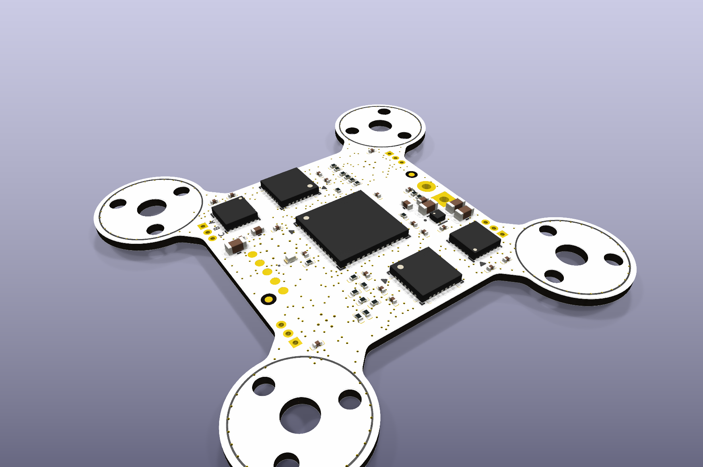
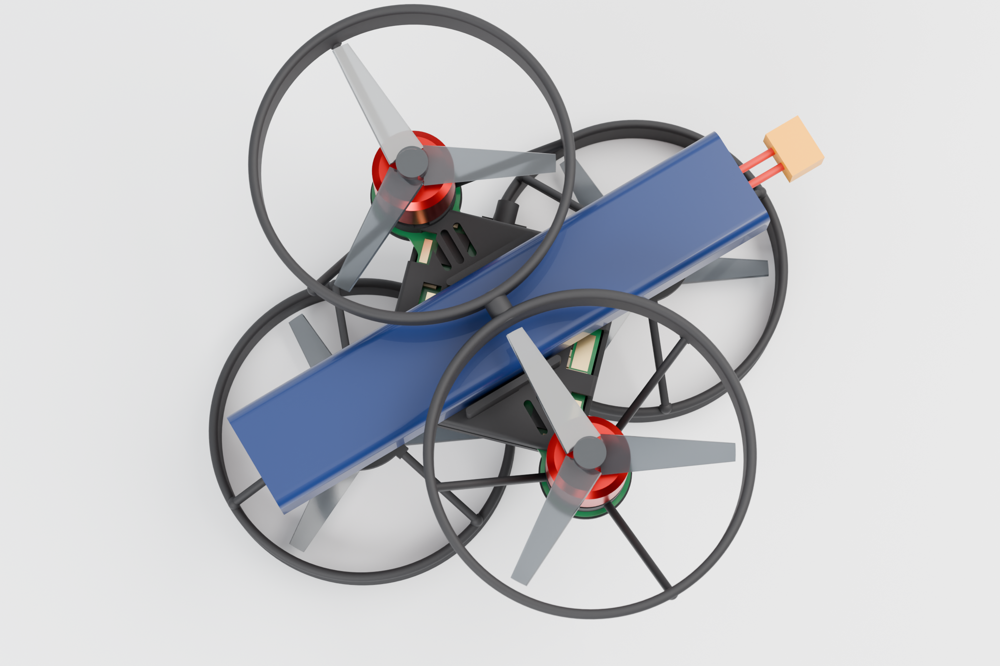

# Nano drone

> [!WARNING]
> **AI-generated and not yet verified in hardware.** This design was produced by Claude (Anthropic's AI) working with
> me. That covers schematic, layout, routing, simulations, fab files and enclosure. No board has been built, powered
> or flown yet. It passes DRC and the simulations in this repo, but simulations are not a substitute for testing.
> Review it yourself before ordering, and use it at your own risk.

> [!NOTE]
> **The controller is not made yet.** This repo has only the drone hardware. Nothing exists yet for the side that
> flies it: no handheld transmitter setup, no phone app, no bridge. The firmware (Rust) for the flight controller and
> the ESCs isn't written either.

A brushless micro quad whose flight board is also its frame: a 36 × 36 mm, 6-layer board carrying an STM32G431
flight controller, four STM32G071 + DRV8311H ESCs, an SX1280 2.4 GHz ELRS radio and an LSM6DSV16X IMU, flying four
0702 motors. Everything is generated by code: schematic, placement, routing, fab outputs and simulations.

  

<b>▶ <a href="media/nanodrone_video.mp4?raw=true">Watch the full video in HD</a></b> (40 s, opens in the browser's player)

## PCB (rev C, fully routed: 110/110 nets, DRC 0 errors)

| Top | Bottom |
|---|---|
|  |  |

## Enclosure

| Assembled | Top view |
|---|---|
|  |  |

## Where things are

- [`hw/README.md`](hw/README.md): the generation pipeline, step by step, and how the rev C board was routed.
- [`hw/docs/ARCHITECTURE.md`](hw/docs/ARCHITECTURE.md): system architecture, pin maps, PCB and EMC design.
- [`hw/docs/FIRMWARE_REQUIREMENTS.md`](hw/docs/FIRMWARE_REQUIREMENTS.md): what the (Rust) firmware must do.
- [`hw/sim_post/POST_LAYOUT_REPORT.md`](hw/sim_post/POST_LAYOUT_REPORT.md): post-layout simulations on the routed copper.
- [`hw/output/fab/`](hw/output/fab/): JLCPCB package (Gerbers, BOM, CPL, order notes, STEP).
- [`hw/docs/ENCLOSURE.md`](hw/docs/ENCLOSURE.md): 3D-printed enclosure.
