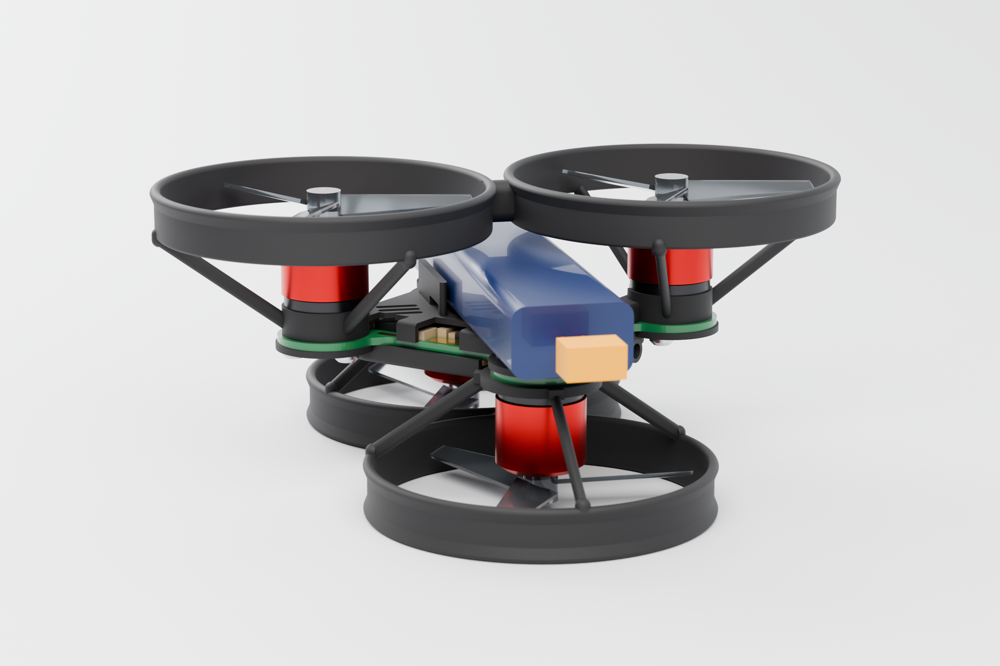
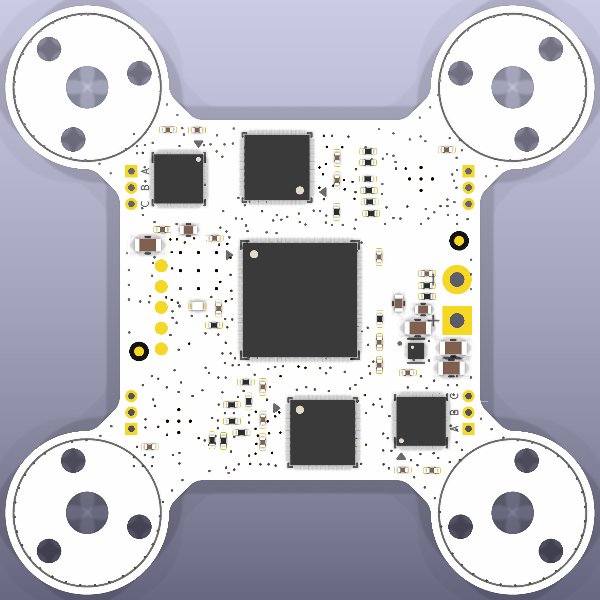
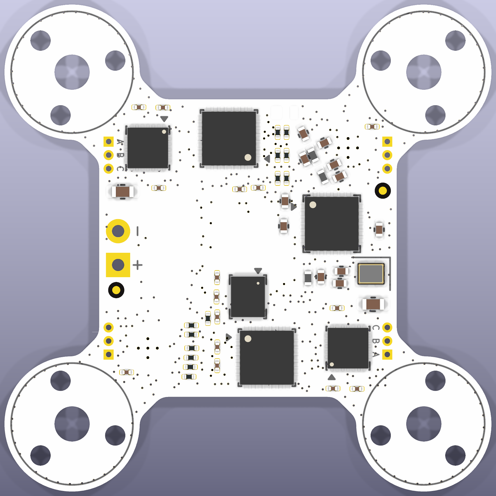
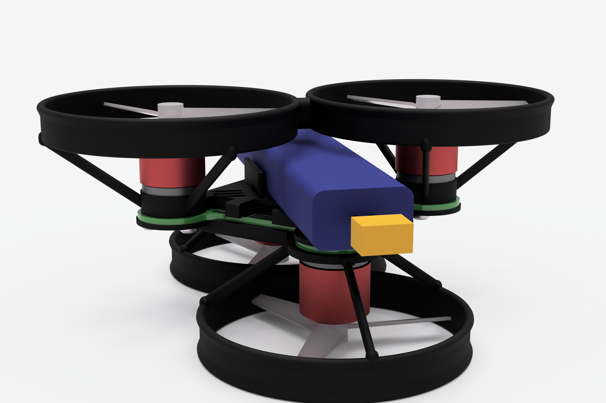

# Nano drone

A brushless micro quad whose flight board is also its frame: a 36 × 36 mm, 6-layer board carrying an STM32G431
flight controller, four STM32G071 + DRV8311H ESCs, an SX1280 2.4 GHz ELRS radio and an LSM6DSV16X IMU, flying four
0702 motors. Everything is generated by code: schematic, placement, routing, fab outputs and simulations.

**▶ [Watch the video](media/nanodrone_video.mp4)** (click the image or link, then GitHub's player opens).

## PCB (rev C, fully routed: 110/110 nets, DRC 0 errors)

| Top | Bottom |
|---|---|
|  |  |

## Enclosure

| Assembled | Top view |
|---|---|
|  |  |

## Where things are

- [`hw/README.md`](hw/README.md): the generation pipeline, step by step, and how the rev C board was routed.
- [`hw/docs/ARCHITECTURE.md`](hw/docs/ARCHITECTURE.md): system architecture, pin maps, PCB and EMC design.
- [`hw/docs/FIRMWARE_REQUIREMENTS.md`](hw/docs/FIRMWARE_REQUIREMENTS.md): what the (Rust) firmware must do.
- [`hw/sim_post/POST_LAYOUT_REPORT.md`](hw/sim_post/POST_LAYOUT_REPORT.md): post-layout simulations on the routed copper.
- [`hw/output/fab/`](hw/output/fab/): JLCPCB package (Gerbers, BOM, CPL, order notes, STEP).
- [`hw/docs/ENCLOSURE.md`](hw/docs/ENCLOSURE.md): 3D-printed enclosure.
