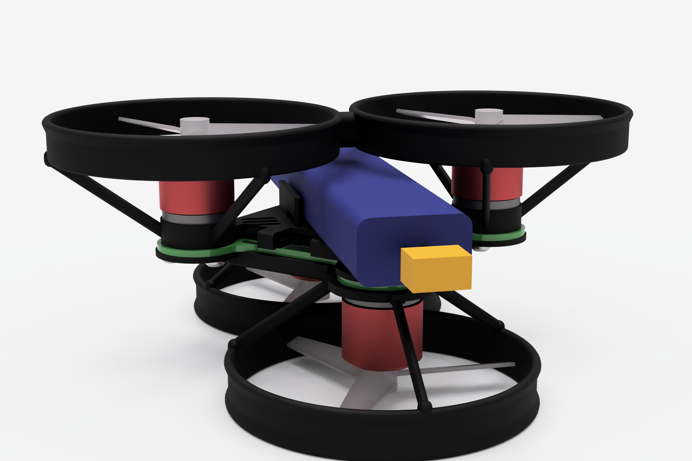

# Enclosure (3D printed)

A two-piece body clamps the flight board. Four rolled-lip prop ducts complete it: two above the board around the top
motors (M1, M4) and two below around the bottom motors (M2, M3). The bottom ducts are also the landing gear, because
the bottom props hang 10 to 14 mm under the board. Fusion generates everything from code, like the rest of `hw/`.

## Files

| What | Where |
|---|---|
| Generator (Fusion script: build, fit checks, STL/STEP export, images) | `mech/fusion/nanodrone_enclosure/nanodrone_enclosure.py` |
| Board reference it builds around (outline, holes, part boxes, motors) | `output/mech/board_ref.json`, written by `tools/board_ref.py` |
| Hand calculations (duct sections, ring mode, struts, landing, mass/TWR, heavier-wall variant) | `mech/enclosure_calcs.py` |
| Print files | `output/mech/enclosure/nanodrone_enclosure_{top,top_lite,bottom}.stl` (mm, watertight) |
| Fusion design (full archive, open or upload in Fusion) | `output/mech/enclosure/nanodrone_enclosure.f3d` |
| CAD exchange | `output/mech/enclosure/nanodrone_enclosure_*.step`, `nanodrone_assembly.step` (board, motors, props, battery, shells) |
| Images | `output/mech/enclosure/renders/` (`render_*` raytraced, `enclosure_*` viewport) |

To regenerate after a placement change:
1. `python tools/board_ref.py kicad/nanodrone.kicad_pcb` (KiCad's Python). The canonical board is now the routed
   rev C board. Today's `board_ref.json` was made from an earlier routing copy. It differs from rev C only in 0201
   resistors: the four nFAULT pull-ups are gone, and motor 4's six BEMF divider resistors sit 0.2 mm further east.
   Outline, holes, motors and every tall part are unchanged, so the shells and fit checks below still hold.
2. In Fusion, open Utilities > Add-Ins > Scripts and Add-Ins, press +, pick `mech/fusion/nanodrone_enclosure`, and run it. It rebuilds the
   components `Enclosure_Top`, `Enclosure_Top_Lite` (hidden) and `Enclosure_Bottom`, plus the stand-ins in
   `Visual`. It then prints the fit checks and rewrites the STL/STEP files. All dimensions are constants at the top
   of the script.

## Design

| Part | What it does |
|---|---|
| Body, top half | Canopy plate 0.6 mm, 1.4 mm above the board. Its 0.6 mm side wall stops at the board face, so the board edge shows as a thin seam between the halves. The outer edge is rounded R0.5 |
| Body, bottom half | Belly plate 0.6 mm, 1.4 mm under the board, same wall and edge |
| Motor bosses (top, M1/M4) | Ø9 x 3.0 mm hollow spacers under the top motors, with a notch where the motor wires leave the base |
| Motor shims (bottom, M2/M3) | Ø12 x 1.0 mm plates between the board and the bottom motors. They carry the bottom-duct struts |
| Clamp tabs | 0.7 mm tabs under the screw heads: top half at M2/M3, bottom half at M1/M4 |
| Ducts | Prop tip gap 1.0 mm, 0.7 mm wall, 1.1 mm rolled inlet lip. Top ducts are 4.9 mm tall (z 10.6..15.5). Bottom ducts are 5.4 mm tall (z -14.8..-9.4) with a 1.1 mm landing bead |
| Struts | Three 0.9 x 1.5 mm fin struts per duct, at the outward direction and ±110°. Each strut stays 0.5 mm clear of its prop disk and ends in a round socket post on the duct wall. A bridge joins the two top ducts over the battery; a keel joins the two bottom ducts |
| Battery bay | Two 3.5 mm rails along the y = x diagonal, 12.6 mm apart, for a 62 x 11.8 x 7 mm 1S 300 mAh pack. A 4.6 x 1.0 mm slot through both rails takes a 4 mm hook-and-loop strap, which runs under the pack and over the top |
| Cooling | Three radial slots over each DRV8311 (U11/U14 in the canopy, U12/U13 in the belly). The belly stays closed over the IMU, so prop wash does not reach its temperature-sensitive bias |
| Openings | Battery pigtail J1, SWD J3 (pogo access once the pack is out), motor pads J11-J14 (soldering access, open to the edge), status LED D1, antenna pads J2 |
| Antenna exit | A chin under J2 with a solder window, and a guide tube (bore 1.6 mm, for 1.13 mm coax or a 1 mm whip) that points the antenna forward in the board plane, between the top and bottom prop planes |

The motor screws hold both halves; there are no extra fasteners. Top boss height (3.0 mm) and bottom shim (1.0 mm)
set the screw lengths so that each screw leaves 1.5 mm of thread in the motor. **Do not use longer screws: they can
reach the stator windings.**

| Motor | Stack (head → motor) | Screw |
|---|---|---|
| M1, M4 (on top) | bottom tab 0.7, PCB 0.8, top boss 3.0 | 3 x M1.4 x 6 pan head (Ø ≤ 2.6 mm) per motor, from below |
| M2, M3 (underneath) | top tab 0.7, PCB 0.8, bottom shim 1.0 | 3 x M1.4 x 4 pan head per motor, from above |

The top motors' base is now at 3.0 mm (the first reference used 3.5 mm). The battery top is at 9.0 mm and the top
props start at 11.5 mm. The screw holes are Ø1.7 mm because MJF holes are ±0.3 mm.

## Variants and mass

`Pro` has all four ducts. `Lite` drops the two top ducts and their bridge (the top props are then open). The bottom
ducts stay in both, since they are the landing gear. Mass comes from the solid volumes.

AUW and TWR come from study 4 in `sim/SIMULATION_REPORT.md`. With the 300 mAh pack, AUW is 16.0 g (dry 7.7 g plus
an 8.3 g pack), and the maximum vehicle thrust is 56.3 / 41.1 / 38.6 g at 4.30 / 3.45 / 3.30 V OCV.

| Variant | Top | Bottom | Enclosure | AUW (300 mAh) | TWR 4.30 V | TWR 3.45 V | TWR 3.30 V |
|---|---|---|---|---|---|---|---|
| Pro (4 ducts), PA12 MJF | 1.66 g | 1.71 g | 3.37 g | 19.4 g | 2.91 | 2.12 | 1.99 |
| Pro (4 ducts), SLA resin | 1.89 g | 1.95 g | 3.84 g | 19.8 g | 2.84 | 2.07 | 1.95 |
| Pro (4 ducts), PETG FDM | 2.09 g | 2.15 g | 4.24 g | 20.2 g | 2.78 | 2.03 | 1.91 |
| Lite (bottom ducts only), PA12 MJF | 0.74 g | 1.71 g | 2.45 g | 18.5 g | 3.05 | 2.23 | 2.09 |
| Lite (bottom ducts only), SLA resin | 0.84 g | 1.95 g | 2.79 g | 18.8 g | 3.00 | 2.19 | 2.05 |
| Lite (bottom ducts only), PETG FDM | 0.93 g | 2.15 g | 3.08 g | 19.1 g | 2.95 | 2.15 | 2.02 |
| No enclosure | - | - | - | 16.0 g | 3.52 | 2.57 | 2.41 |

Study 4's soft limit is TWR 2. In PA12, Pro reaches it at the 3.30 V landing voltage; Lite stays above it on a full
discharge. Choose Pro for crash protection on all four props, or Lite for the last minute of punch.

The ducts are about 60 % of the enclosure mass. The TWR columns ignore the duct effect. With a 1.0 mm tip gap
(3 % of the prop diameter) and a rounded inlet lip, short ducts like these usually give back a few percent of static
thrust. Measure it before counting on it. The CG is on the thrust axis (x and y within 0.01 mm). It sits 2.5 mm
above the board top for Pro and 2.0 mm for Lite, between the top and bottom prop planes.

The overall envelope with the ducts is 61.2 x 61.2 x 30.3 mm. The battery and its plug stay inside the duct
footprint.

## Fit checks (run by the generator)

The checks use the minimum distance and the overlap volume of each shell against every reference body and every
stand-in. For the overlap test, 0.000 mm³ means no interference.

| Against | Top half | Bottom half | Note |
|---|---|---|---|
| PCB | 0 (contact) | 0 (contact) | clamped only at the motor mounts |
| Components (113 boxes) | ≥ 0.40 mm (C38) | ≥ 0.40 mm (U13) | lateral; 0.5 mm above the tallest parts |
| Prop disks (31 mm, full hub height) | 0.70 mm | 0.70 mm | strut nearest the disk edge; duct wall 1.0 mm |
| Prop blades | 1.00 mm | 1.00 mm | duct wall |
| Motor bells (rotating) | 1.25 mm | 0.74 mm | bottom: the cup wall that joins shim and belly |
| Screw heads | 0 (seated, M2/M3) | 0 (seated, M1/M4) | ≥ 1.5 mm from the other half's heads |
| Battery pack | 0 (rests on the canopy) | 2.8 mm | 0.4 mm side play per rail |

All overlaps are 0.000 mm³. Each shell is one solid, and the exported STLs have no non-manifold edges.

## Strength and dynamics (estimates, `mech/enclosure_calcs.py`)

| Check | Top duct | Bottom duct |
|---|---|---|
| Section area | 3.67 mm² | 4.36 mm² |
| I in-plane (ovalising) | 0.213 mm⁴ | 0.296 mm⁴ |
| I out-of-plane (vertical) | 7.3 mm⁴ | 11.4 mm⁴ |
| Free-ring in-plane mode n=2 | 481 Hz | 518 Hz |
| Strut length / angle | 16.2 mm / 36° | 13.4 mm / 35° |
| Strut Euler buckling (K 0.7, weak axis) | 9.5 N | 13.9 N |
| Strut compressive yield | 56 N | 56 N |
| Vertical load per duct before struts bow | 17 N | 24 N |

* Landing flat on both bottom ducts, the struts stay straight up to about 250 g of deceleration (48 N). Beyond that
  the PA12 struts bow elastically and spring back; nylon was chosen for that.
* Side hits load the rings in plane. The rings are soft that way (0.2 to 0.3 mm⁴) and the struts and bridge share
  the load, so a duct flexes and recovers instead of cracking. Prop contact during a hard wall hit is expected, as
  on any whoop.
* The free-ring ovalising mode (about 0.5 kHz, raised somewhat by the struts) sits inside the motor-frequency sweep.
  That is why `docs/FIRMWARE_REQUIREMENTS.md` F10 asks for RPM-locked gyro notches. Check the blackbox gyro spectrum
  on the first flights. If a fixed peak shows up there, add a notch or stiffen the lip (`LIP_R`).

## Printing

* **Recommended: JLC3DP MJF PA12 (HP), dyed black.** It is tough, needs no supports, and orientation is free. Its
  density of 1.01 g/cm³ gives the masses above.
* JLC's design guide recommends 1.0 mm walls (1.5 mm for parts of this size) and quotes ±0.3 mm. The ducts (0.7 mm
  walls, 1.1 mm lip and bead) and the plates (0.6 mm) are thinner than that, to save weight, so expect a thin-wall
  notice on the order. Two other ways to go:
  * Accept the notice. The load paths are the rounded lips, beads and struts.
  * Set `WALL = 1.0` and `SKIN = 0.8` in the generator, rebuild and re-export. That is sturdier and about 0.64 g
    heavier (Pro 4.0 g, Lite 2.85 g; estimate from `mech/enclosure_calcs.py`).
* SLA resin prints finer but is brittle. It suits the Lite top; resin ducts crack in crashes.
* FDM: walls this thin need a 0.25 mm nozzle. PETG works. TPU (95A) bottom ducts survive crashes best, at the cost
  of weight.
* Tolerances the design already allows for: screw holes Ø1.7 mm, 12.6 mm battery bay for an 11.8 mm pack,
  1.0 mm strap slot, ≥0.4 mm to components, 1.0 mm prop tip gap.

## Assembly

1. Solder the battery pigtail to J1 and the antenna to J2. Thread the antenna's free end through the bottom shell's
   guide tube before closing.
2. Set the bottom half under the board (shims under M2/M3, tabs under M1/M4) and the top half over it (bosses at
   M1/M4, tabs at M2/M3).
3. Mount M1 and M4 on the bosses with M1.4 x 6 screws from below. Mount M2 and M3 under the shims with M1.4 x 4
   screws from above. Put a drop of low-strength threadlocker on the motor thread only.
4. Solder the motor wires to J11-J14 through the edge notches. They leave the motor base towards their pads; the
   bosses and the bottom cup walls are notched for them.
5. Fit the pack between the rails. Put its connector at the M2 (front-right) end, which is closest to J1. Pass the
   strap through both rail slots, under the pack and over the top.
6. Press the props on and check that each one spins freely inside its duct.

## Fusion notes

* The design is kept as a Fusion archive, `output/mech/enclosure/nanodrone_enclosure.f3d`, which the export step
  rewrites. To get it into the cloud, open it in Fusion (File > Open > Open from my computer) or upload it from the
  Data Panel. A brand-new document can only get its first cloud save from the Fusion UI. A `saveAs` from an MCP
  script creates the cloud entry, but the upload never completes.
* In the Fusion build used here, `TemporaryBRepManager.createTorus` ignores its centre point. The generator builds
  tori at the origin and translates them (`torus_at`).
* STEP export skips hidden components, so the generator unhides the Lite top while it exports it.
