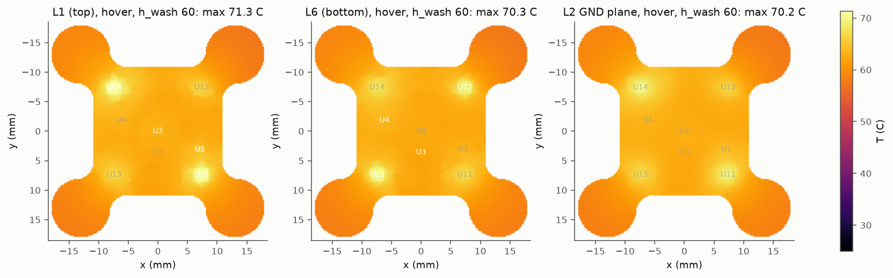
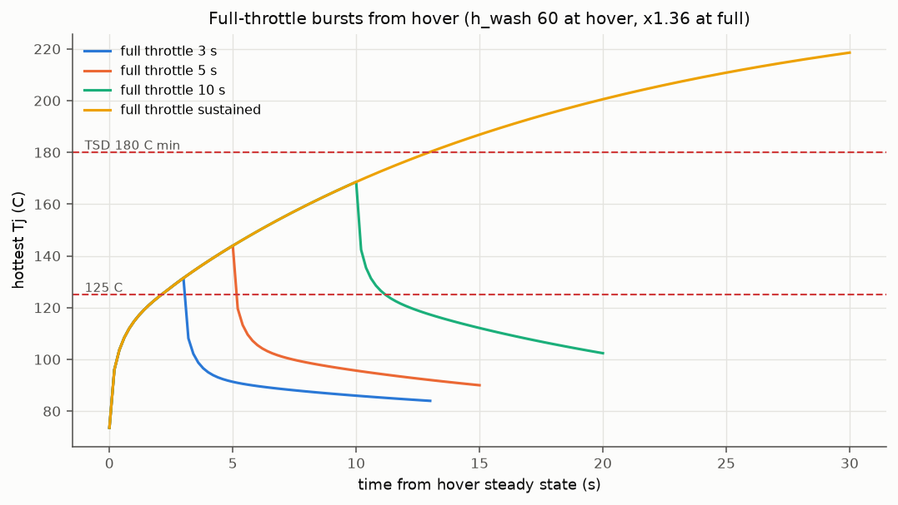
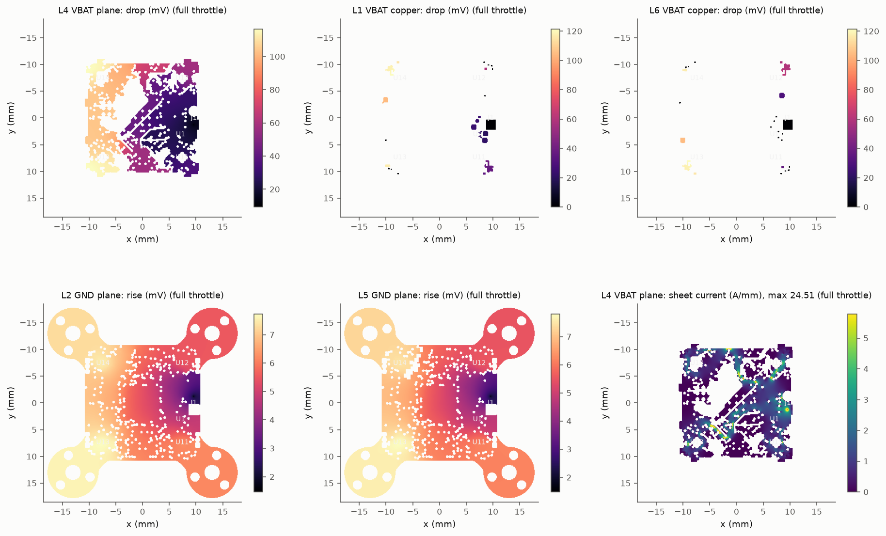
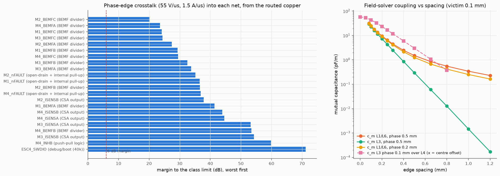
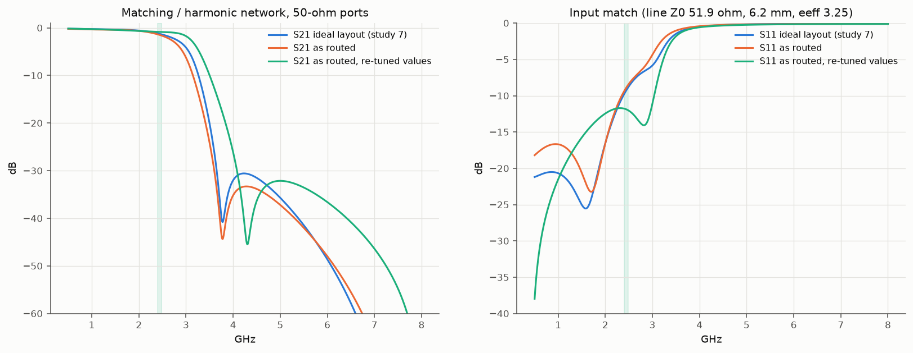
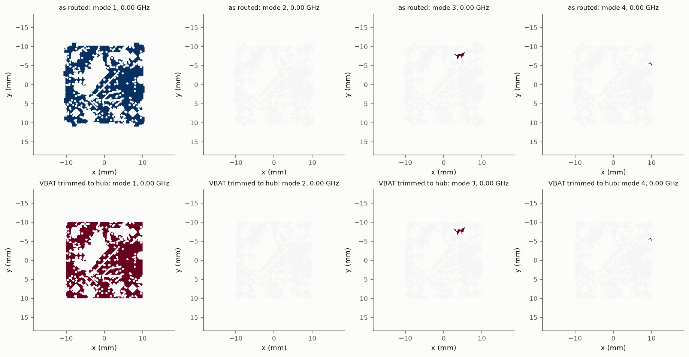
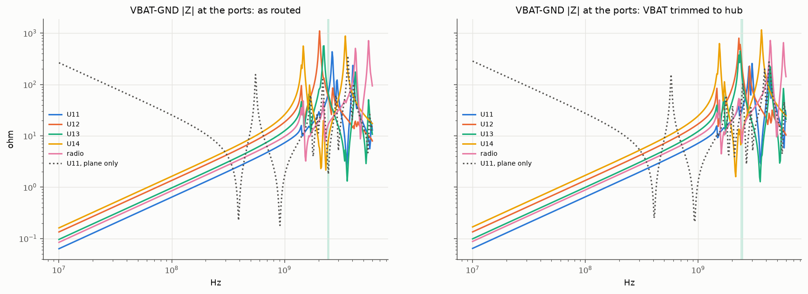
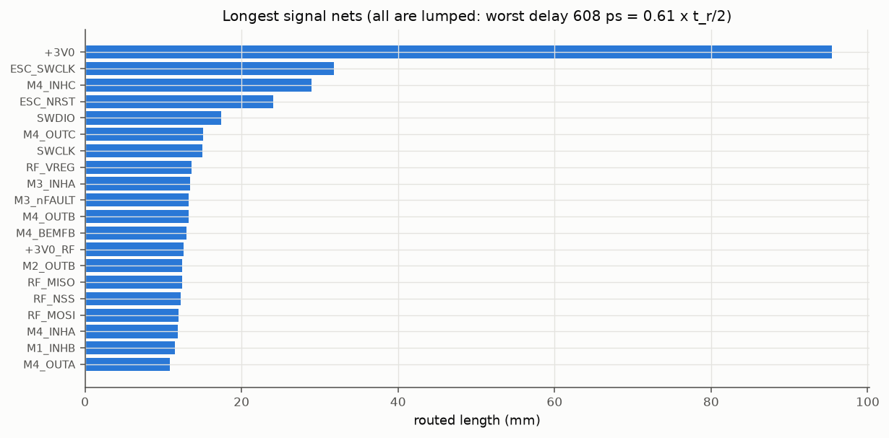

# Nano drone flight board: post-layout simulation report

Every number here is computed from the **routed copper** of `hw/kicad/nanodrone.kicad_pcb`:
- the real track, pad and filled-zone geometry, rasterised at 0.05 mm;
- every via;
- the stackup written into the board.

The pre-layout studies (`hw/sim/SIMULATION_REPORT.md`) set the operating points and component models used
here. Reproduce with `python run_post.py`, then `python report.py`, from `hw/sim_post/`, using KiCad's bundled
Python 3.11. Figures are in `out/`.

## Summary

| Study | Result on the routed board | Verdict |
|---|---|---|
| P1 thermal | Hover, 96 kHz PWM, h_wash 60: Tj max **74 C**. Worst-case parts: 103 C. Still air: 168 C. Full throttle from hover: 125 C after **2.10 s**, 150 C after 6.08 s. IMU at hover: 62 C | hover **PASS**; full throttle **time-limited**, firmware must enforce it |
| P2 IR drop | Full throttle (9.3 A): VBAT+GND loop drop to the worst driver **129 mV**, copper loss 854 mW. 4 A/driver peak: 224 mV. Worst via current 1.61 A | MARGINAL |
| P3 crosstalk | Phase edges (55 V/us) into every net: smallest margin **20.2 dB** (M2_BEMFC, BEMF divider). Signal vias with no GND via within 1 mm: 56 of 262. Plane-changing vias (L1/L3 to L4/L6) with no GND via within 1 mm: 35 of 158. | PASS |
| P4 RF feed | Line Z0 **51.9 ohm** (eeff 3.25). Fence spacing max 4.69 / 4.50 mm. As routed: IL 1.61 dB, RL 8.6 dB in band, 2f0 36 dB, 3f0 78 dB | PASS |
| P5 plane cavity | VBAT/GND cavity modes in 1.8-3.2 GHz: 1.96 GHz, 2.19 GHz, 2.88 GHz. Max VM-port impedance in the ISM band 80.8 ohm | PASS |
| P6 nets | All nets lumped (worst +3V0: 608 ps = 0.61 x t_r/2). 52 MHz crystal stray +0.72 pF -> 8.2 ppm pull. 3V0 DC drop max 2.4 mV | PASS |

## Design changes forced by these checks (layout rev A)

| Found by | Problem | Fix |
|---|---|---|
| P4 gap scan | The RF feed left the SX1280 RFIO pin sideways and ran along the pin row, over GND pins 21 and 20: a short | Radio rotation forced so the RFIO row faces the antenna; 0.6 mm stub straight out of the pin row |
| P4 gap scan | Four shunt caps of the matching network were placed GND-pad-first: each RF stub crossed its cap's GND pad (4 shorts) | RF pad faces the line, 0.05 mm from its node's series pad; GND pad away, with filled via-in-pad |
| P4 network | Each 0402 pad over the 0.1 mm L6-L5 prepreg is a 0.18 pF shunt: as routed, the network detuned (2.5 dB IL, 6.9 dB RL) | L5 rule-area cut-outs under the RF signal pads (they see L4 0.26 mm down, about 0.07 pF): within 0.3 dB of the reference |
| P5 cavity | Full-size VBAT plane: plane-pair cavity mode at 2.39 GHz, inside the radio band and near the 14th harmonic of the 170 MHz FC clock | VBAT plane limited to the hub and arm roots (L4 GND in the motor discs): first mode about 2.7 GHz |
| Router + DRC | RF via fence at 0.5 mm pitch made an all-layer wall between the M4 ESC MCU and its driver | Fence pitch 1.0 mm (lambda/70 at 2.45 GHz), topped up after routing where room allows |
| DRC | Motor wire pads at the driver corner: 0.09 mm from the package, 0.16 mm from the VM pin | Pads moved to a column beside the OUT edge: 0.4 mm clearance, sub-mm phase traces |
| DRC | ESC MCU outer pad rows 0.21 mm from the board edge (0.25 mm rule) | ESC MCUs moved 0.3 mm inward |
| Router | Motor pads at 1.27 mm pitch fanned out faster than the driver's 0.4 mm OUT pins, so phase A had no path on any motor | Motor pads 0.75 mm / 0.4 mm drill at 1.0 mm pitch, at x = +/-10.3 mm: every OUT pin escapes with one 45 deg jog |
| Router subset test | ESC MCU BEMF/CSA inputs (PA0-PA4) sat on the edge facing away from the driver, directly over the neighbouring ESC MCU on the other side: no via could reach them | Pin swap to the driver-facing corner (BEMF PB1/PB0/PA7, CSA PA6/PA5, nFAULT PB3); zero-cross becomes ADC-based |
| Router subset test | BEMF dividers at the motor-pad column were boxed in by the driver's back-side exposed pad; in motor 4's corner the RF chain took their place | Compact divider pairs on the opposite side between driver and ESC MCU; motor 4's pairs in explicit columns east of the RF line |
| Router subset test | Driver decoupling caps sat 0.35 mm past the escape stubs, sealing the driver's rear pin row | Routing channel around drivers/ESC MCUs widened 0.6 -> 0.9 mm; 100 nF VM caps moved under the VM corner on the opposite side |
| P2 IR drop | Driver VM corner point computed on the wrong axis: 1-2 VM vias per driver (one via carrying 4 A peak), one via inside a pin | Corner track wraps outside the package with 2-3 VM vias per driver (12 total); vias kept 0.45 mm from pad centres |
| P5 cavity | Covering every VBAT via with a square plane moved the first cavity mode down to 2.66 GHz | Hub-square VBAT plane plus narrow lobes to the outlying VBAT vias: first mode 3.14 GHz |
| DRC | Fan-out vias co-located or too close (hole-to-hole), and vias next to motor-phase copper or the board edge | Drill-web guard (0.2 mm) in every via placer and in the router; class-safe clearance margin; edge check |
| DRC | rf_isolation rule compared B.Net (a net code) with 'GND', so it also held the GND pour 0.20 mm off the RF line | Rule uses B.NetName: the coplanar gap is the intended 0.15 mm (50 ohm) |
| DRC | Fiducial mask openings exposed the GND pours | Pour keep-outs around the fiducials |
| Pre-layout 5a | VDDA ferrite + 1 uF resonance: x5.6 noise gain at 333 kHz | 10 ohm RC filter instead of the ferrite |
| Pre-layout 9 | PWM frequency / slew trade-off | 96 kHz PWM, SLEW = AGND (no hardware change) |
| Fit | The antenna-tuning pi (0R + 2 DNP) no longer fit on the shorter feed | Dropped; C22/L1 are the tuning elements |

## P1: thermal (`ps1_thermal.py`)

**Model.**
- 19657 cells per layer at 0.2 mm on 6 copper sheets, 120142 nodes in total.
- In-plane conductance comes from the real copper fill.
- FR4 couples the sheets through the thickness.
- 366 power vias and plated holes are explicit barrels, with 1918 via-to-layer ties.
- Total heat capacity 1.52 J/K.
- Convection: h_wash in the prop discs, 12 W/m2K elsewhere, plus 7 W/m2K radiation.
- 15 % of each bottom motor's loss enters its mounting disc.
- Driver loss comes from the hw/sim switching model at the operating point, and RDS(on) follows Tj.

| Scenario | U11 | U12 | U13 | U14 | IMU | FC | radio | LDO |
|---|---|---|---|---|---|---|---|---|
| hover, h_wash 60 (nominal) | 73 | 72 | 73 | 74 | 62 | 63 | 64 | 66 |
| hover, h_wash 30 | 104 | 103 | 103 | 104 | 92 | 93 | 94 | 97 |
| hover, h_wash 100 | 59 | 58 | 58 | 59 | 48 | 49 | 50 | 52 |
| hover worst (3 uH, RDS max), h_wash 60 | 102 | 100 | 101 | 103 | 83 | 84 | 85 | 88 |
| hover at 48 kHz, h_wash 60 | 94 | 92 | 93 | 94 | 77 | 78 | 79 | 82 |
| hover, still air (h 12) | 167 | 166 | 167 | 168 | 154 | 154 | 156 | 159 |
| full throttle steady, h_wash 60x1.36 | 239 | 233 | 238 | 242 | 170 | 171 | 178 | 179 |

Driver loss per DRV8311 at Tj 100 C:
- hover at 96 kHz: 0.569 W (conduction 0.403 + diode, switching and standby 0.167);
- hover at 48 kHz: 0.780 W;
- full throttle: 2.29 W.

**Full-throttle budget, starting from hover steady state:** Tj reaches 125 C after 2.10 s, 150 C after 6.08 s, and 175 C after 11.58 s. Full throttle cannot be sustained: the steady state is above the 180 C thermal shutdown.

**Compact model for the ESC/FC firmware** (Foster fit of Zth(t), the same 1 W on all four junctions, h_wash 60, max fit error 0.52 C):

| pole | R (C/W) | tau (s) |
|---|---|---|
| 1 | 6.97 | 0.018 |
| 2 | 11.74 | 0.330 |
| 3 | 44.28 | 16.773 |

Tj_est = T_board + sum of three first-order filters of P_loss. P_loss is per driver:
1.5 x I_ph,rms^2 x RDS(on),HS+LS(Tj_est) + 0.17 W at 96 kHz. This matches the switching model within 7 %
at hover and at full throttle. RDS(on) is 0.30 ohm at 25 C, 0.45 ohm at 150 C. I_rms comes from the CSA. Seed T_board with the
G071 internal temperature sensor. Recommended limit: start derating at an estimated 130 C and reach
hover-level current at 150 C.

**Copper-weight option:** with 1 oz inner layers, hover Tj is 67/67/67/67 C and the 3 s burst peak is 111 C. Ask JLC for the 1 oz inner-layer stackup at order time if it is offered for 0.8 mm.

## P2: DC IR drop and current density (`ps2_irdrop.py`)

| Case | Total A | VBAT drop U11/U12/U13/U14 (mV) | GND rise (mV) | Loop max (mV) | Copper loss (mW) | Max via current (A) |
|---|---|---|---|---|---|---|
| hover | 1.8 | 8/12/23/23 | 1/1/2/1 | 24 | 31 | 0.17 |
| full throttle | 9.3 | 40/62/121/121 | 7/6/8/8 | 129 | 854 | 0.92 |
| peak 4 A/driver | 16.2 | 69/107/210/210 | 11/10/14/14 | 224 | 2589 | 1.61 |

## P3: crosstalk and return paths (`ps3_xtalk.py`)

Coupling coefficients come from 2-D field solves of the real layer cross-sections: L1/L6 microstrip under
mask, the L3 stripline between GND and VBAT, and L3 over L4 between the L2 and L5 GND planes. Every victim
track is checked against the nearest parallel phase track on its layer. A victim on L4 is also checked
against the phase tracks on L3 above it, because where L4 carries escape routing there is no plane between
the two layers. The L2 and L5 GND planes screen every other layer pair.

Broadside coupling between L3 and L4 (phase on one layer, victim on the other): 15 nets, 16.29 mm coupled in total, worst M1_BEMFB at 29 dB margin.

| Net | Class | Coupled length (mm) | Closest (mm) | C_m (fF) | Glitch (mV) | Limit (mV) | Margin (dB) |
|---|---|---|---|---|---|---|---|
| M2_BEMFC | BEMF divider | 1.88 | 0.33 | 2.57 | 0.712 | 7.3 | 20 |
| M4_BEMFA | BEMF divider | 1.57 | 0.37 | 1.73 | 0.483 | 7.3 | 24 |
| M1_BEMFC | BEMF divider | 0.84 | 0.31 | 1.64 | 0.453 | 7.3 | 24 |
| M3_BEMFC | BEMF divider | 1.03 | 0.29 | 1.64 | 0.441 | 7.3 | 24 |
| M2_BEMFA | BEMF divider | 0.89 | 0.30 | 1.12 | 0.311 | 7.3 | 27 |
| M1_BEMFB | BEMF divider | 1.32 | 0.35 | 0.90 | 0.250 | 7.3 | 29 |
| M4_BEMFC | BEMF divider | 0.88 | 0.37 | 0.88 | 0.245 | 7.3 | 29 |
| M3_BEMFB | BEMF divider | 1.44 | 0.53 | 0.62 | 0.173 | 7.3 | 32 |
| M3_BEMFA | BEMF divider | 0.75 | 0.47 | 0.53 | 0.150 | 7.3 | 34 |
| M2_nFAULT | open-drain + internal pull-up | 1.33 | 0.00 | 28.78 | 15.748 | 900.0 | 35 |
| M1_nFAULT | open-drain + internal pull-up | 1.86 | 0.00 | 24.64 | 13.486 | 900.0 | 36 |
| M2_BEMFB | BEMF divider | 0.44 | 0.35 | 0.39 | 0.108 | 7.3 | 37 |
| M4_nFAULT | open-drain + internal pull-up | 4.56 | 0.17 | 23.76 | 12.980 | 900.0 | 37 |
| M2_ISENSB | CSA output | 3.54 | 0.23 | 5.48 | 0.093 | 7.3 | 38 |
| M1_BEMFA | BEMF divider | 0.14 | 0.44 | 0.23 | 0.063 | 7.3 | 41 |

## P4: RF feed as routed (`ps4_rf.py`)

| Segment net | Length (mm) | Width (mm) | GND gap min/median (mm) | Reference | Z0 (ohm) |
|---|---|---|---|---|---|
| ANT | 1.23 | 0.120 | 0.146 / 0.260 | L4 (relief) | 74.7 |
| RF_N1 | 0.68 | 0.120 | 0.367 / 0.401 | L4 (relief) | 78.9 |
| RF_N1 | 0.79 | 0.120 | 0.367 / 0.412 | L4 (relief) | 79.0 |
| RF_N1 | 0.65 | 0.120 | 0.387 / 0.472 | L4 (relief) | 79.8 |
| RF_N2 | 0.78 | 0.120 | 0.343 / 0.401 | L4 (relief) | 78.9 |
| RF_N2 | 0.68 | 0.120 | 0.387 / 0.412 | L4 (relief) | 79.0 |
| RF_N2 | 0.65 | 0.120 | 0.367 / 0.393 | L4 (relief) | 78.7 |
| RF_IO | 0.50 | 0.120 | 0.190 / 0.275 | L4 (relief) | 75.4 |
| RF_IO | 0.65 | 0.120 | 0.367 / 0.387 | L4 (relief) | 78.6 |
| RF_IO | 0.60 | 0.120 | 0.140 / 0.209 | L5 | 51.9 |

- ideal layout (study 7): IL 1.36 dB, RL 8.9 dB (2.400-2.4835 GHz), 2f0 attenuation 35 dB, 3f0 86 dB
- as routed: IL 1.61 dB, RL 8.6 dB (2.400-2.4835 GHz), 2f0 attenuation 36 dB, 3f0 78 dB
- as routed, re-tuned values: IL 0.86 dB, RL 11.8 dB (2.400-2.4835 GHz), 2f0 attenuation 32 dB, 3f0 52 dB
- RF signal pads with the L5 relief cut-out: 11 of 11
- Monte Carlo, 400 boards (part tolerances +/-0.05 pF / +/-0.1 nH, pad C +/-20 %, line Z0 +/-5 %): IL median 1.64 dB, 95th percentile 1.98 dB; in-band RL median 8.4 dB, 5th percentile 7.3 dB
- Line Z0 over the stackup tolerance: nominal (h 0.0994, er 4.45) 50.3 ohm, er 4.16 51.5 ohm, er 4.25 51.1 ohm, h -10 % 48.0 ohm, h +10 % 52.3 ohm, h +10 %, er 4.16 53.5 ohm, mask 20 um 49.6 ohm

Post-layout re-tune: these values make the as-routed network reproduce the reference 2-port. Use them
as the VNA starting point if the BOM values measure off. RMS |dS11| to the reference: 0.169.

| Part | BOM | Continuous optimum | Nearest standard value |
|---|---|---|---|
| C24 | 0.5 pF | 0.27 pF | 0.3 pF |
| L1 | 3.0 nH | 3.55 nH | 3.6 nH |
| L2 | 2.5 nH | 3.41 nH | 3.0 nH |
| C22 | 0.8 pF | 0.32 pF | 0.4 pF |
| C23 | 1.2 pF | 0.75 pF | 0.8 pF |
| C25 | 1.2 pF | 0.61 pF | 0.6 pF |

## P5: VBAT/GND plane cavity (`ps5_cavity.py`)

- as routed: first modes 0.55, 1.49 GHz; modes in 1.8-3.2 GHz: 1.96, 2.19, 2.88; max |Z| at the VM ports in the ISM band 80.79 ohm
  - VM-loop effective inductance (nH): U11 1.01, U12 2.15, U13 1.54, U14 2.58, radio 1.35; VM bounce on a 2.8 A / 114 ns edge (mV): U11 25, U12 53, U13 38, U14 63, radio 33
- VBAT trimmed to hub: first modes 0.58, 1.49 GHz; modes in 1.8-3.2 GHz: 2.03, 2.49, 2.95; max |Z| at the VM ports in the ISM band 311.18 ohm
  - VM-loop effective inductance (nH): U11 1.03, U12 2.15, U13 1.58, U14 2.70, radio 1.41; VM bounce on a 2.8 A / 114 ns edge (mV): U11 25, U12 53, U13 39, U14 66, radio 34

## P6: nets, timing, crystal, 3V0 rail (`ps6_nets.py`)

- RF_XTA: 9.06 mm routed, trace 1.20 pF + pads 0.48 pF
- RF_XTB: 5.68 mm routed, trace 0.79 pF + pads 0.48 pF
- 3V0 DC drop from the LDO: U11 1.2 mV, U12 2.3 mV, U13 1.4 mV, U14 2.4 mV, U2 1.5 mV, U21 1.3 mV, U22 2.2 mV, U23 1.3 mV, U24 2.2 mV

